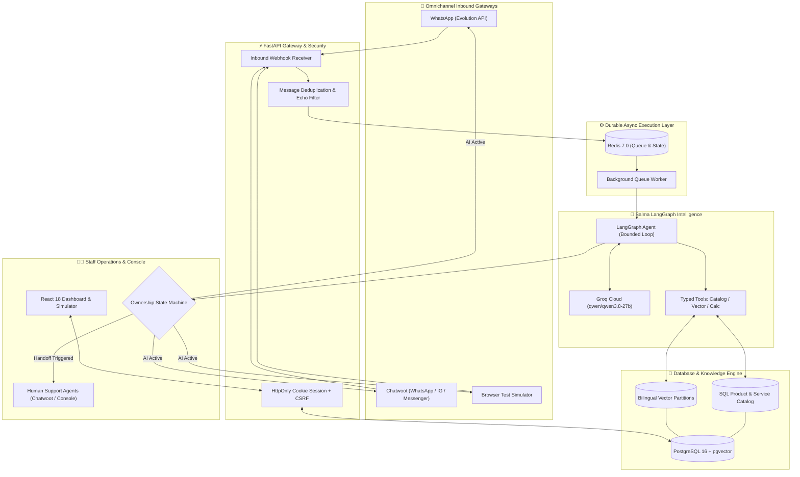

# 🌟 Salma: Autonomous Inbound Sales & Operations AI Agent

<div align="center">

[](https://www.python.org/)
[](https://fastapi.tiangolo.com/)
[](https://langchain-ai.github.io/langgraph/)
[](https://groq.com/)
[](https://github.com/pgvector/pgvector)
[](https://redis.io/)
[](https://react.dev/)
[](https://www.docker.com/)
[](https://pytest.org/)

**A production-grade, multi-tenant AI Inbound Sales & Operations Agent engineered for guaranteed factual accuracy, anti-hallucination guardrails, bilingual Arabic & English fluency, and seamless omnichannel engagement.**

[Key Features](#-key-features) • [Architecture](#-system-architecture) • [Quickstart](#-quickstart-guide) • [Multi-Tenant Console](#-owner--operator-console) • [Verification](#-testing--verification) • [Documentation](#-project-documentation)

---

</div>

## 📌 Executive Overview

**Salma** is an enterprise-ready inbound sales and operations platform. Unlike brittle chatbots or generic wrappers around raw LLMs, Salma implements a **dual-agent architecture** backed by deterministic state machines, vector databases, and strict business guardrails:

1. **Owner Setup Assistant (Configuration Co-pilot):** Analyzes business documents, discovers products and services, drafts lead qualification questions, and generates operational policies with business owner review.
2. **Customer Sales & Operations Agent:** Handles customer inquiries, quotes strictly verified catalog prices, scores and qualifies leads, and gracefully transitions conversations to human staff when necessary.

Salma guarantees **zero fabricated prices**, **zero unauthorized discounts**, and **complete data isolation** between business tenants, speaking both **Modern Standard Arabic / Egyptian Colloquial Arabic (العامية المصرية)** and **English**.

---

## ✨ Key Features

### 🧠 Dual-Agent Intelligence (LangGraph & Groq)
- **Bounded Tool Loop:** Executes catalog lookups, semantic document search, arithmetic calculations, and lead state updates through strict typed tools before an atomic structured decision call.
- **Powered by Groq `qwen/qwen3.8-27b`:** Sub-second inference latency with deep reasoning for nuanced customer negotiations.

### 🛡️ Ironclad Anti-Hallucination & Pricing Safeguards
- **Deterministic Price Rendering:** Prices and currency amounts are rendered directly by backend Python logic from approved SQL catalog records—never hallucinated or negotiated by the LLM.
- **Restricted Arithmetic Calculator:** Prevents prompt-injection price exploits; discounts require verified catalog coupon rules or explicit staff approval.
- **Evidence-Backed Answers:** Vector retrieval cites specific document filenames and page numbers. Missing business knowledge automatically triggers clarifying inquiries or human handoff.

### 🌐 Scoped Multilingual RAG Knowledge Base
- **Dual Partition pgvector Architecture:**
  - `all-MiniLM-L6-v2` for high-accuracy English retrieval.
  - `paraphrase-multilingual-MiniLM-L12-v2` for Arabic (MSA and Egyptian dialect).
- **Text PDF & TXT Ingestion:** Ingests documents up to 20 MB with recursive token-aware chunking and background indexing.

### 📦 Dynamic Product & Service Catalog
- **High-Capacity Inventory:** Supports up to **10,000 active variants** per business workspace with SKU tracking, category grouping, and variant management.
- **Batch Excel & CSV Import:** Full spreadsheet parser with column auto-mapping, preview approval, and idempotent upserts.
- **Flexible Pricing Models:** Fixed pricing, starting-from quotes, tiered units, and conditional offers (e.g., student discounts with ID verification).

### 🔄 Atomic Draft & Publish Engine
- **Zero-Downtime Revisions:** Configuration changes made via the Setup Assistant or manual forms remain in persistent draft state.
- **Immutable Published Snapshots:** Publishing creates an atomic, versioned snapshot of instructions, rules, products, and approved knowledge vectors.
- **Instant Rollback:** Revert instantly to any previous published version without impacting in-flight customer interactions.

### 🤝 Bulletproof Human Handoff State Machine
- **Predictable Lifecycle:**
  $$\text{AI\_ACTIVE} \longrightarrow \text{HANDOFF\_PENDING} \longrightarrow \text{HUMAN\_ACTIVE} \longrightarrow \text{CLOSED}$$
- **Automated Handoff Triggers:** Explicit customer request, pricing negotiation, angry sentiment/complaint, missing knowledge, or provider timeout.
- **Pre-Send Race Condition Check:** Re-verifies conversation ownership immediately prior to dispatching outbound messages, preventing the AI from talking over human agents.
- **Authenticated Staff Control:** AI replies remain paused until human staff explicitly click **Resume AI** in the dashboard.

### 📱 Omnichannel Live Messaging
- **Native WhatsApp Integration:** Direct routing via [Evolution API](https://evolution-api.com/) (`WhatsApp ➔ Evolution ➔ Salma ➔ Evolution`) with QR code pairing straight from the browser console.
- **Omnichannel Live Chat & Socials:** Bridges with [Chatwoot](https://www.chatwoot.com/) for unified WhatsApp, Instagram Direct, and Facebook Messenger management.
- **Durable Processing:** Redis-backed worker queues, inbound webhook deduplication, bot-echo suppression, and outbox reconciliation.

---

## 🏗️ System Architecture



---

## 🛠️ Technology Stack

| Layer | Technologies |
| :--- | :--- |
| **Backend Core** | Python 3.14, FastAPI 0.115+, SQLAlchemy 2.0, Alembic, Pydantic v2 |
| **Agent & LLM** | LangGraph 1.0+, Groq Cloud (`qwen/qwen3.8-27b`), Tenacity retries |
| **Embeddings & RAG** | Sentence-Transformers (`all-MiniLM-L6-v2`, `paraphrase-multilingual-MiniLM-L12-v2`), PyPDF, pgvector |
| **Databases & Cache** | PostgreSQL 16 (with `pgvector` extension), Redis 7.0 (Append-Only persistence) |
| **Frontend Console** | React 18, Vite, Lucide Icons, Vanilla CSS Design System |
| **Messaging Connectors** | Evolution API v2 (WhatsApp Direct), Chatwoot API (Omnichannel CRM) |
| **Security & Auth** | Opaque Redis-backed HttpOnly cookies, CSRF protection, AES credential encryption |
| **DevOps & Tooling** | Docker Compose, uv package manager, Ruff linter, Pytest |

---

## 🚀 Quickstart Guide

### 📋 Prerequisites
- **Docker & Docker Compose** installed and running
- **Python 3.14+** (managed via `uv` or standard virtual environment)
- **Node.js 20+** (only required if building frontend outside Docker)

---

### 1️⃣ Clone and Initialize Environment

```bash
# Clone the repository
git clone https://github.com/AnasOsama2/AI-Agent-Inbound-Sales-Operator.git
cd AI-Agent-Inbound-Sales-Operator

# Initialize .env file with cryptographically secure keys
python scripts/init_env.py
```

> [!TIP]
> To enable live Groq LLM inference, open `.env` and configure:
> ```env
> AGENT_MODE=groq
> GROQ_API_KEY=your_groq_api_key_here
> INSTALL_KNOWLEDGE=true
> ```
> By default, `AGENT_MODE=simulator` runs locally without requiring external API keys.

---

### 2️⃣ Start Services via Docker Compose

```bash
docker compose up --build -d
```

Verify that all containers are healthy:
- **Web Console:** [http://localhost:5173](http://localhost:5173)
- **FastAPI Backend:** [http://localhost:8000](http://localhost:8000) (Swagger Docs: [http://localhost:8000/docs](http://localhost:8000/docs))
- **PostgreSQL (pgvector):** `localhost:5433`
- **Redis:** `localhost:6380`

---

### 3️⃣ Provision Pilot Workspaces & Demo Data

Run the platform pilot setup script:

```powershell
# Windows PowerShell
.venv/Scripts/python.exe scripts/setup_platform_pilots.py
```

```bash
# Linux / macOS
python scripts/setup_platform_pilots.py
```

This automated provisioning script will:
1. Create operator and business owner accounts.
2. Ingest bilingual knowledge bases (PDFs) and seed structured catalogs for two realistic business pilots:
   - 🦷 **Bright Nile Dental Clinic:** Medical consultation scheduling (300 EGP), teeth cleaning (600 EGP), student discount rules, and clinic operational hours.
   - 🚗 **Harbor Auto Care:** Maintenance service packages (900 EGP oil change), parts catalog, and appointment intake.
3. Securely save owner and operator access credentials to `data/local-access.json`.

---

### 4️⃣ Sign In to the Console

1. Navigate to **[http://localhost:5173](http://localhost:5173)** in your browser.
2. Open `data/local-access.json` to copy the generated credentials for either **Operator** or **Business Owner**.
3. Explore the workspace!

---

## 🖥️ Owner & Operator Console

The web console provides business owners and operators with an all-in-one cockpit:

```
┌────────────────────────────────────────────────────────────────────────┐
│  SALMA PLATFORM CONSOLE                               [Bright Nile ▼]  │
├──────────────┬─────────────────────────────────────────────────────────┤
│ 📊 Overview  │ Business metrics, channel status, published revision    │
│ 🤖 Assistant │ Conversational Setup Co-pilot: chat to update rules     │
│ 📚 Knowledge │ Drag-and-drop PDF/TXT upload, status, page-level search │
│ 🏷️ Products  │ Services & product catalog, Excel/CSV importer, SKU map │
│ ⚙️ Settings  │ Operating hours, lead scoring weights, handoff triggers │
│ 📡 Channels  │ WhatsApp QR scan (Evolution), Chatwoot inboxes, status  │
│ 💬 Test Chat │ Real-time simulation with LangGraph trace & score view  │
│ 📥 Inbox     │ Live conversations, human takeover, conversation logs  │
└──────────────┴─────────────────────────────────────────────────────────┘
```

### 🎮 The 8 Dedicated Console Modules:
1. **Overview:** View workspace health, active channel bindings, publication version, and quick metrics.
2. **Setup Assistant:** Interactive conversational assistant that guides owners through tone of voice, service definitions, qualification questions, and policies—producing reviewable draft proposals.
3. **Knowledge:** Upload and manage business documentation with vector indexing status and page-by-page verification.
4. **Products & Services:** Comprehensive catalog manager with Excel/CSV bulk import, SKU assignment, prices, currency, and promotional rules.
5. **Agent Settings:** Fine-tune handoff rules, lead temperature thresholds (Cold, Warm, Hot), and boundary instructions.
6. **Channels:** Pair WhatsApp via direct QR code scanning using Evolution API; connect and map Chatwoot inboxes.
7. **Test Chat (Simulator):** Chat with your agent in English or Arabic with **live deep inspection**:
   - Real-time tool execution logs
   - Cited evidence documents and page numbers
   - Extracted lead fields & temperature score
   - Ownership state transitions
8. **Conversations:** Monitor incoming chats across all channels, review handoff reasons, and step in as human staff with a single click.

---

## 🧪 Testing & Verification

Salma includes an exhaustive automated test suite covering race conditions, tenant isolation, anti-hallucination policies, and vector retrieval.

### Run Unit & Integration Tests

```powershell
# Sync dependencies
uv sync --native-tls --extra dev --extra knowledge

# Run Pytest suite
$env:PYTHONPATH = 'backend'
$env:TEST_DATABASE_URL = 'local'
.venv/Scripts/python.exe -m pytest -q

# Run Ruff Linter
.venv/Scripts/ruff.exe check backend tests migrations

# Verify Frontend Production Build
cd frontend
npm run build
```

### Run End-to-End Verification Scripts

| Script | Purpose |
| :--- | :--- |
| `scripts/verify_owner_flow.py` | Validates Setup Assistant proposals, draft reviews, publication, and rollback. |
| `scripts/verify_pilot_sales.py` | Tests realistic sales dialogs against Groq LLM across pricing, Arabic dialect, discounts, and handoff. |
| `scripts/verify_restart_safety.py` | Simulates sudden Redis/worker crashes to verify zero conversation data loss. |
| `scripts/verify_product_catalog.py` | Exercises high-volume catalog imports (up to 10,000 SKUs) and variant queries. |

---

## 🔒 Security & Enterprise Trust

- **Tenant Isolation:** Every SQL query, vector partition search, and channel event is strictly scoped to the authenticated workspace ID.
- **Server-Side AES Encryption:** Sensitive third-party API credentials (Evolution API tokens, Chatwoot keys) are encrypted at rest using `CREDENTIAL_KEY`.
- **Session Security:** Opaque, Redis-backed `HttpOnly`, `SameSite=Lax` cookies with anti-CSRF token verification on all mutating endpoints.
- **Anti-Scraping & Privacy:** Private access files (`data/local-access.json`), uploaded knowledge originals, and internal reasoning traces are excluded from public responses and version control.

---

## 📁 Repository Structure

```text
├── backend/                  # FastAPI Application & LangGraph Intelligence
│   └── salma/
│       ├── agent.py          # LangGraph state graph & tool definitions
│       ├── api.py            # FastAPI main app & legacy router
│       ├── platform_api.py   # Multi-tenant workspace APIs & draft/publish engine
│       ├── product_catalog.py# High-capacity product & service catalog models
│       ├── product_imports.py# Excel/CSV batch import engine
│       ├── knowledge.py      # Dual-model PDF/TXT text extraction & chunking
│       ├── evolution_channel.py # Native Evolution API WhatsApp connector
│       ├── adapters.py       # Chatwoot & Simulator message normalization
│       ├── trust.py          # Anti-hallucination verification & price rendering
│       ├── worker.py         # Resilient async background worker & outbox
│       └── store.py          # PostgreSQL session management & pgvector store
├── frontend/                 # React 18 Owner Console & Inspection Dashboard
│   ├── src/
│   │   ├── main.jsx          # Multi-tenant UI with 8 modular management views
│   │   ├── ProductCatalog.jsx# Advanced catalog & Excel/CSV import component
│   │   └── style.css         # Modern dark-mode responsive design system
├── migrations/               # Alembic database schema migrations
├── scripts/                  # Automated verification & pilot setup utilities
│   ├── setup_platform_pilots.py # Provisions Bright Nile Clinic & Harbor Auto Care
│   ├── verify_pilot_sales.py    # Live LLM sales conversation evaluation
│   ├── verify_owner_flow.py     # Owner proposal, publish & rollback test
│   └── init_env.py              # Environment initialization & key generator
├── docs/                     # Technical specifications & architectural decisions
│   ├── platform-quickstart.md   # Step-by-step onboarding walkthrough
│   ├── spec.md                  # Core engineering specification & contracts
│   └── product-catalog-implementation.md # Catalog design ledger
└── compose.yaml              # Docker Compose multi-service deployment spec
```

---

## 📖 Project Documentation

- 📘 [Platform Quickstart Guide](docs/platform-quickstart.md) — Comprehensive guide to invitations, documents, publication, and channel pairing.
- 📐 [Technical Specifications](docs/spec.md) — Detailed architecture, bounded tool loops, state machines, and acceptance criteria.
- 🏷️ [Product Catalog Implementation Ledger](docs/product-catalog-implementation.md) — Design constraints, 10k variant performance, and Excel import rules.
- 📱 [WhatsApp Delivery Diagnosis](docs/whatsapp-delivery-diagnosis.md) — Troubleshooting Evolution API webhook delivery and phone pairing.

---

## 🤝 Contributing & License

Contributions, bug reports, and suggestions are welcome!

1. Fork the repository: `https://github.com/AnasOsama2/AI-Agent-Inbound-Sales-Operator`
2. Create a feature branch: `git checkout -b feature/amazing-feature`
3. Commit your changes: `git commit -m 'Add amazing feature'`
4. Push to branch: `git push origin feature/amazing-feature`
5. Open a Pull Request.

Distributed under the **MIT License**. See `LICENSE` for more information.

<div align="center">
<sub>Engineered with precision for autonomous, trustworthy conversational commerce.</sub>
</div>
